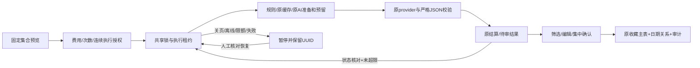

# 阶段 4：有限连续分批智能整理

开发分支：`codex/stage4-bounded-favorite-ai`，基于已上线 V1.10.1 的 main。此次只开发和隔离验证，未部署网站、Edge 或生产 SQL；正式网站仍为 V1.10.1。

## 使用流程与授权边界

收藏库新增「一键智能整理 · 有限连续分批」。范围支持全部待处理、仅新增（从未保存 AI 整理）、仅资料/上下文变化、已核实地区、自选地点；只纳入当前未归档且指纹未完成的地点。预览列出固定地点、发送字段、规则/缓存/模型统计、批次、单批最高预留及全局剩余金额/次数/token。只有模型判断需要发往 DeepSeek；规则、缓存和状态核对不调用模型。

用户明确勾选数据发送与自动连续执行许可，并指定费用和模型请求上限，才创建执行授权。每个任务最多150地点、每批最多5个、2小时有效；授权冻结 ID、版本、上下文指纹及预算版本，不会扩展到后来导入记录。规则/人工分类先处理，复用原缓存；模型串行，每次模型完成后至少等10.1秒，再由原服务端全局10秒限流及每日请求/token/金额预算作最终裁决。

进度显示待处理、规则/人工、缓存、模型、失败、待审数量、实际费用及未结算/失败预留。可暂停、恢复、停止；停止不退款、不撤销已发送请求。页面关闭/离开收藏页面不再启动下一批；已发送请求可继续完成。没有后台服务、Cron 或“关页继续运行”能力。

任务独占执行者 UUID + 共享会话哈希，执行租约120秒。切设备须先核对共享任务；活租约不会被抢走，过期租约可显式恢复。响应不明先查询原 UUID，待处理期间不发新收费请求；90秒未完成沿用原保守失败结算。失败项需明确勾选核对声明后跳过，不自动重试；如要重试这些地点，需要停止旧任务并另行预览授权。已有成功结果及缓存保留。

## 集中审核

建议只保存在原 `favorite_ai_jobs` 和任务记录，不在生成时修改收藏/日期。按地区、类型、推荐日期、置信度筛选，选择筛选组或逐条选择，编辑类型及有可靠地区匹配的推荐日期，再明确确认。前端每次最多确认25个，初始只渲染30个建议，按需展开更多。

每次选中集合全量校验版本/上下文后原子保存，任一条过期或审计失败则整组选中项回滚。保存回执绑定 UUID 和摘要；网络丢失后只能核对原保存，不新建一次确认。已有人工地区、类型、日期、备注保留。此任务不写地区/核实证据，不把 AI 置信度转换为“已核实”，也不调用正式行程 apply。

离线只显示明确标注的本机最后快照，不能授权、执行或保存；重新联网后核对服务端状态再恢复，不自动继续计费。退出解锁状态清空相关 UI 和原收藏离线存储，沿用现有隐私机制。

## 复用与文件改动

- `supabase/functions/ai-trip/favorites.js`：在原 `handleFavoriteAI` 内选择任务准备/完成动作，模型调用仍只有原 `complete`；继续使用 `favorite-ai-core.js` 的输入脱敏、规则及严格输出校验。没有新增 provider、Secrets、前端 Key 或收费链。
- `supabase/functions/ai-trip/handler.js`：增加任务动作白名单，原 CORS、正文限制、会话检查不变。
- `supabase/v1_10_favorite_bulk.sql`：增量私有任务/批次映射/审核回执三表、索引和兼容 RPC 包装。复用原收藏 AI 作业、缓存、ai_usage、预留/结算和共享 gate 锁；固定锁顺序为 gate → task → 原预算/请求。事务内短暂传递最多5项计划，无网络请求持有数据库事务锁。
- `favorite-bulk-client.js`：有限串行驱动、先保存 UUID、核对、暂停和离开时停止，最多30批；不自动重试付费请求。
- `favorite-bulk-ui.js`、`favorite-ai-ui.js`、`favorites.css`：范围与预算预览、控制、恢复、分页编辑审核、离线快照和安全渲染。保留原单批入口，原单批历史不混入任务批次，任务批次不可绕过集中审核接口确认。
- `sw.js`：只增加新模块到缓存并更换开发缓存名，不删除 IndexedDB/离线队列。
- `tests/favorite-bulk.test.js`、`qa/migration-v110*.mjs`、`qa/favorite-bulk-browser.mjs`、`qa/browser-v14.mjs`、`package.json`：任务单元/数据库/手机验收接入原完整测试。

新表全部 RLS 开启，撤销 PUBLIC/anon/authenticated 权限；继续由既有 service_role RPC 包装和共享解锁访问。不新增公共收藏表，不改正式行程或已有业务格式，不增加收费依赖。

## 验证矩阵

| 项目 | 结果/证据 |
| --- | --- |
| npm test | 141/141，原137项保留，新增有限循环/暂停/不明请求/锁定晚回包测试 |
| npm run test:db | 原 V1.1–V1.9.3 全部隔离回归 + 新任务SQL/真实Edge handler通过；迁移重复执行通过 |
| 94条合成场景 | 20规则 + 74待模型，19批，15次模拟模型调用；集中审核前收藏记录逐项不变 |
| 缓存复用 | 74模型结果复用原缓存，新任务缓存批次无新模型调用 |
| 并发/恢复 | provider被阻塞时两个设备请求只发起一次模型；活租约拒绝抢执行；暂停后原请求可完成；其他会话核对不重计费 |
| 预算/限流 | 任务费用/次数上限、共享全局10秒限流、预算版本变化停止；失败保留原预留额，不自动重试 |
| 数据/权限 | 拒绝未解锁、客户端无RPC/表权限、原公开invoker入口兼容；原单批不可确认任务批次 |
| 原子审核 | 多选第二条审计故障回滚第一条；同UUID确认重放只产生原修订 |
| 人工保护 | 人工地区、类型、日期、备注无损；正式行程修订数不变 |
| 授权边界 | 过期拒绝、请求UUID跨任务复用拒绝、资料/上下文过期拒绝、新导入不扩展固定集合 |
| 手机/离线 | Chrome/WebKit 320/390/768 无横向溢出；11合成地点3个串行规则批次；分组编辑确认、丢失保存响应恢复、离线刷新快照及退出清理通过 |
| 输入安全 | 地点中的HTML作为文本渲染，未产生img或执行脚本 |

完整浏览器测试覆盖原收藏单批AI、行程、离线日语、地区核实、票券、只读分享、账本、五设备同步与冲突。日志：`qa-results/bulk-unit-final.log`、`bulk-db-final.log`、`bulk-chrome-final.log`、`bulk-webkit-final.log`。手机截图：`qa-results/bulk-review-{320,390,768}-{chrome,webkit}.png`，全部合成数据。

最终 Chrome 全量运行曾在五设备上下文关闭后的菜单切换发生一次焦点超时；QA 的 openTab 补充 bringToFront，保留原导航点击与断言，完整重跑通过，没有跳过用例。

测试中的密码学函数仅在隔离 PGlite 夹具替身；未将替身用于生产。未使用真实94条CSV、未调用真实收费模型、未导入/修改生产数据。双设备并发验证使用真实Edge handler + 隔离SQL与阻塞的模拟provider，不冒充生产多连接压力测试。实体手机仍需验收。

## 发布与回退（尚未执行）

批准后：先核对各设备待同步记录并备份；检查最新生产基线；应用 `v1_10_favorite_bulk.sql`；部署包含根目录依赖的原 `ai-trip` 完整包，保留现有 Secrets/JWT/预算；核对权限、租约与零模型请求的状态接口；最后发布前端与新SW。`shared-trip`、`app.js`、`index.html` 无本阶段改动，减少后续聊天室/旅行模式合并冲突。版本号在获准发布时单独提高。

回退优先隐藏入口/回退前端并更新缓存名，保留三张私有状态/审计表与原作业/使用记录。先显式停止任务，不再启动新批次，再视需要还原旧 ai-trip 源包；已发送请求应先核对/完成结算。不要DROP表、清队列、改AI预算、回放整库备份或删除历史。已确认的数据按修订机制人工恢复。

限制：单次最多150地点/2小时；租约失联最多需等120秒；不能恢复已过期任务的新执行或新确认，可新建授权复用仍有效缓存。失败预留费用不宣称退款。生产安全顾问/真实设备/实际服务端依赖核对留到批准部署时进行；本阶段没有触碰生产。
