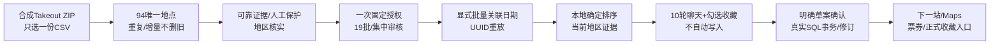

# 阶段9｜系统联调与待审批发布

候选版本 `2.1.0-rc.1`；分支 `codex/stage9-system-acceptance`。本阶段仅在隔离环境写入和执行测试；生产仅做只读元数据/数量/权限核对，未发布、未迁移、未导入、未调用真实收费模型。

## 四种状态

| 范围 | 代码已完成 | 隔离测试已通过 | 生产已部署 | 生产验收已完成 |
|---|---|---|---|---|
| 阶段1—3 | 是 | 是，已回归 | 历史V1.10/V1.10.1 | 以各阶段旧发布报告为准，不代表本候选 |
| 阶段4—6 | 是 | 是，已回归 | 历史V1.11 | 以旧发布报告为准，不代表本候选 |
| 阶段7 聊天室 | 是 | 是 | **否** | **否** |
| 阶段8 旅行模式 | 是 | 是 | **否** | **否** |
| 阶段9 修复/联调/发布包 | 是 | 本机自动化通过；真机安装等人工项见限制 | **否** | **否** |

远端main及生产迁移仍停留V1.11，`public.ai_chat_request` 尚不存在；不能将“代码完成/测试通过”说成“新版已上线”。五台真实设备、原生安装PWA和真实模型语义不冒充自动化已完成。

每阶段提交记录及完整文件清单见 [提交与文件台账](docs/stage9/STAGE-COMMITS-AND-FILES.md)；本阶段发布/迁移方案见 [生产方案](release/PRODUCTION-PLAN.md)。

## 本次补齐的系统验证

`npm run test:system` 使用**同一个隔离PGlite数据库**，运行真实共享门禁、收藏、日期、费用、草案、apply_batch和历史SQL，依次执行：

结果：合成94条唯一地点、19批、15次模拟收藏模型调用、10轮模拟问答及1次模拟草案生成；真实收费请求0、地理API请求0、未确认正式行程写入0。真实SQL确认只增加预期修订，重复确认不增加记录。正式行程版本变化会使旧地区证据失效，必须重新人工核对；未把历史摘要或AI猜测提升为已核实事实。收藏加入正式行程也需要单独主动确认，且没有复制收藏主表。

数据来自运行时生成的合成ZIP/CSV，没有读取或提交真实94条CSV。只读查询看到生产既有94收藏，不是本阶段导入结果；数量前后相同。Git当前及可见历史无CSV/ZIP/.env提交，新增忽略规则和发布审计防止误提交。CI只运行合成数据，不将私人CSV或附件上传artifact。

## 联调发现并修复

1. **PWA代际一致性**：旧SW网络优先存在混用新旧模块的风险。准备V1.11兼容桥；新SW改为同代缓存优先、完整预缓存后激活，预缓存加代际标识以绕过旧缓存，公开握手确认真正接管。无业务库清理。用户跳过桥的设备仍是发布前待核对项。
2. **聊天切换竞态**：快速新建/恢复/切换会话期间，发送区可能提前可用。现在串行恢复/新建/切换，期间禁用发送和范围控件；保留旅行日期/翻译快捷预选。新增人为延迟IndexedDB创建的确定性测试。
3. **发布证据与CI**：增加整链、PWA升级、源码/隐私产物/Edge依赖/资源哈希审计；CI按Chrome/WebKit执行。修正匿名smoke的旧V1.11缓存标记，避免新版本发布后错误失败。

## 测试证据与矩阵

| 检查 | 结果 | 关键覆盖 |
|---|---|---|
| `npm test` | 158项通过 | 原功能与地区/日期/排序/聊天/旅行核心边界 |
| `npm run test:db` | 完整链通过 | 权限、RLS/RPC授权、共享锁、原子回滚、幂等、版本冲突、历史、预算/次数/token/限流、失败核对 |
| `npm run test:system` | 通过 | 同一批94合成地点贯穿B/A/E/D/聊天/J；真实SQL确认与人工字段保护 |
| `npm run test:browser` Chrome | 通过 | 收藏、日程、账本、票券、日语、分享、聊天室、旅行模式和多人更新回归 |
| `npm run test:browser` WebKit | 通过 | 相同回归；新增会话切换延迟测试、IME、失败恢复与旧入口 |
| `npm run test:pwa` Chrome/WebKit | 均通过 | 精确V1.11→兼容桥→新资源缺失/失败安装→联网仍为完整旧界面→新版接管后离线→恢复同步 |
| PWA保留检查 | 通过 | 行程和收藏的原UUID/待同步内容、本机短句、聊天草稿、私有文件缓存保留；重连每条只增加一个版本 |
| `npm run test:release` | 通过 | 73项shell资源、四函数完整导入树、文件SHA256、无私有数据/密钥字面量、桥可复现 |

证据JSON与升级后离线截图在 `docs/stage9/`。阶段7的长表格/恶意Markdown/手机聊天截图在 `docs/stage7/`；320/360/390/430/768及横屏旅行截图在 `docs/stage8/`。截图来自实际浏览器渲染、使用合成数据，不是生产资料或设计图。

隔离基础设施crypto/auth/storage为替身，业务SQL和Edge handler是真实代码；模拟provider返回严格结构。它验证传递、费用保护及写入边界，不证明真实模型的日语质量或指代理解准确率。GitHub CI已配置但本阶段未推送/运行云端CI，不能声称其已通过。

## 只读生产安全核对

2026-11-13核对：生产 `ai-trip` v13、`shared-trip` v9、`trip-files` v4、`share-trip` v4；迁移包含v1.12每日排序，尚无聊天迁移。33张相关private/public业务表均启用RLS，anon/authenticated无直接表读写；原公开收藏/AI RPC无客户端执行权。票券桶 `osaka-tickets` 为私有、单文件5MiB，类型限PDF/JPEG/PNG/WebP。未请求Secrets值或修改配置。

生产数量只读前后均为：94收藏、85行程记录、187行程修订、16 AI使用记录。预算仍为CNY平日2元、旅行10元，保守单价上限8元/百万tokens。没有用生产数据做写入探针。

安全顾问仍有既有提示：31项private表“RLS开启但无policy”的INFO，与撤销客户端表权限、仅服务端门禁RPC的设计一致；另有1项 Supabase Auth 泄漏密码保护未启用的WARN。当前PWA使用自建共享密码门禁，不使用Supabase Auth个人账号；该开关不能替代共享密码保护。本阶段未擅自启用或改付费计划，保留为已知平台提示；不能宣称“安全顾问零告警”。

## 费用预估与授权

本阶段真实模型/Places/语音API费用 **0**。导入、可靠地区、本地排序、日期关系、历史查看与旅行模式不发起收费调用。

核对的[DeepSeek官方人民币计价](https://api-docs.deepseek.com/zh-cn/quick_start/pricing/)中，Flash高峰输入缓存未命中2元、输出8元/百万tokens；当前8元×总tokens的应用记账为保守估计，实际供应商账单为准。价格会变化，生产发布当天须再核对；不要用美元表直接当人民币。

按现有最坏16000预留tokens计算，单次最高预留0.128元。94地点全部需要模型时最多19批，粗略最坏累计2.432元；10轮聊天再按最坏1.28元。规则/缓存可减少调用；这些数字不是新授权。任务cap、共享日预算、请求/token限额或10秒限流任一不足即停止/暂停，不能为了完成94条绕过平日2元预算。失败/停止不撤销已计费请求；结果不明先核对原UUID，不能换号自动重试。

## 尚需人工与生产批准

- 原生iOS/Android安装PWA、真实键盘/系统日语声音、外部Maps与系统附件查看器的真机确认；manifest/浏览器离线验证不等于OS安装验收。
- 五台实际设备的未同步记录、未核对请求、私有本机资料与兼容桥接管清单；本地模拟设备不能代替这份清单。
- 如需要真实模型语义验收，另行限定文本、日期、请求数和费用；当前没有执行。
- 生产备份/恢复验证、迁移、Edge、桥与前端发布均等待批准。详细顺序和无破坏回退见 `release/PRODUCTION-PLAN.md`。

本候选具备可审查的代码和隔离自动化证据；生产部署、生产验收两项保持“未完成”。
